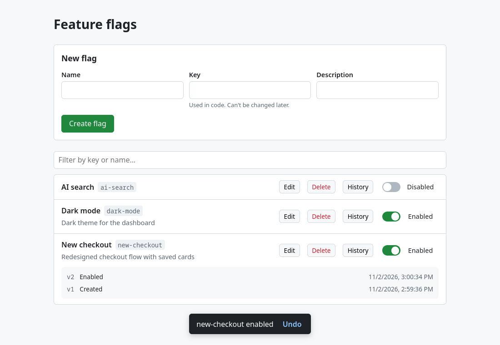

# Feature Flag Manager

A small app for managing feature flags: view them, toggle them on and off, create, edit and delete them, and see each flag's history. It's built as a first iteration that teammates could keep developing.



- **Backend:** FastAPI, SQLAlchemy 2 (async) and SQLite, tested with pytest
- **Frontend:** React 19, TypeScript and Vite, tested with Vitest, React Testing Library and MSW
- **Domain vocabulary:** [GLOSSARY.md](GLOSSARY.md). **Key decisions:** [docs/adr/](docs/adr/)

## Running it

You need Python 3.13+ with [uv](https://docs.astral.sh/uv/), and Node 22+.

```sh
make setup       # install backend and frontend dependencies
make backend     # terminal 1: API on http://localhost:8000 (OpenAPI docs at /docs)
make frontend    # terminal 2: UI on http://localhost:5173
```

Open **http://localhost:5173**. The Vite dev server forwards `/api` to the API, so the browser only ever talks to one origin. That means no CORS configuration is needed.

If port 8000 is busy, pick another one for both commands: `make backend API_PORT=8010` and `make frontend API_PORT=8010`.

The database is a SQLite file, `backend/flags.sqlite3`, created on first start. To use a different one, set `FLAGS_DATABASE_URL`. `FLAGS_LOG_LEVEL` sets the log level.

```sh
make test        # backend and frontend tests
make lint        # ruff (Python) and oxlint (TypeScript)
```

## What it does

- **View flags**, sorted by key and filterable by key or name.
- **Toggle a flag.** The switch flips instantly (an optimistic update) and settles on the server's answer. If the request fails, it flips back and says why. After a toggle, a toast offers **Undo** for 8 seconds.
- **Create a flag** with a name, a key and an optional description. The key is suggested from the name (`New Checkout Flow` becomes `new-checkout-flow`) until you edit it yourself. New flags start **disabled**: a fresh flag usually guards unfinished code. Server-side validation errors appear next to the field they belong to.
- **Edit** a flag's name and description. The key can never change, because it's how code refers to the flag.
- **Delete** a flag after a confirmation. Its key stays reserved forever, but its name becomes free again.
- **History:** each flag records every change (what changed from what to what, and when), shown newest first.
- **Concurrent edits are detected, not lost.** Every change states the version it's based on. If someone else changed the flag first, you get a message ("new-checkout had already been edited. Check current values.") and see the current values, instead of silently overwriting their work. See [ADR 0002](docs/adr/0002-optimistic-concurrency-control.md).

## API

All endpoints are under `/api/v1`. Interactive docs are at `http://localhost:8000/docs`.

| Method & path | Body / params | Success | Errors |
|---|---|---|---|
| `GET /flags` | | 200: flags sorted by key | |
| `POST /flags` | `{key, name, description?}` | 201: the flag | 409 key/name taken · 422 |
| `PATCH /flags/{key}` | `{version, enabled?, name?, description?}` | 200: the flag | 404 · 409 version conflict / name taken · 422 |
| `DELETE /flags/{key}` | `?version=N` | 204 | 404 · 409 · 422 |
| `GET /flags/{key}/history` | | 200: changes, newest first | 404 |
| `GET /health` | | 200 `{"status": "ok"}` | 503 when the DB is unreachable |

Every error uses the same shape, [RFC 9457 Problem Details](https://www.rfc-editor.org/rfc/rfc9457) (`application/problem+json`):

```json
{
  "type": "version_conflict",
  "title": "'new-checkout' had already been edited. Check current values.",
  "status": 409,
  "current": { "key": "new-checkout", "enabled": true, "version": 3, "...": "..." },
  "request_id": "36fcdbc4a03e47c394ac3baeec410a3f"
}
```

`type` is a stable code that clients can branch on. `errors` maps fields to messages for validation problems. `current` comes with version conflicts.

## Observability

- **Request IDs:** every response carries an `X-Request-ID` header. A well-formed incoming one is reused, so a caller's trace continues; otherwise a new one is generated. The ID is also included in error bodies, and the UI shows a short reference on failures (`ref 36fcdbc4`) that support can look up.
- **Structured JSON logs:** one `request.completed` line per request (method, path, status, duration), plus domain events (`flag.created`, `flag.updated` with the changed fields, `flag.deleted`). Every line carries the request ID.
- **Health:** `GET /api/v1/health` checks the database.

## Project layout

```
backend/
  app/
    main.py            # create_app(): wiring, middleware, routers
    config.py          # settings from FLAGS_* environment variables
    db.py              # async engine, one session per request (FastAPI dependency)
    observability.py   # request IDs, JSON logging, access log
    problems.py        # Problem Details error responses
    flags/
      models.py        # Flag and FlagChange tables
      schemas.py       # API request/response shapes and validation rules
      service.py       # the use cases; the one place that changes flags
      errors.py        # every way an operation can be refused, and its HTTP status
      router.py        # HTTP <-> service
  tests/               # API-level tests (full app in-process via httpx)
frontend/src/
  api/                 # typed fetch client, Problem Details errors
  features/flags/      # reducer, provider, list, switch, forms, dialogs, toast
  test/                # MSW fake network, helpers
docs/adr/              # architecture decision records
```

## Testing approach

The code was built test-first. Tests go through public boundaries, not internals, so refactoring doesn't break them:

- **Backend:** each test drives the real app over HTTP (`httpx` + `ASGITransport`, middleware included) against its own fresh SQLite database. Logs are asserted as an operator-facing output.
- **Frontend:** the pure `flagsReducer` is unit-tested. User flows (toggle with rollback and conflicts, create, edit, delete, filter, undo, history) render the whole app with React Testing Library, with the network faked by MSW.

## Assumptions

- A single team with a single set of flags: no environments, no projects. Flags are booleans.
- No authentication, as the brief suggests skipping it. So history records *what* and *when*, but not *who*. The request ID links each change to its log lines.
- The list is small enough to load in one request and filter in the browser (no pagination).
- SQLite is enough for a first iteration. The code uses only SQLAlchemy features that also work on Postgres.

## Tradeoffs I chose

- **Optimistic concurrency from day one.** It costs a `version` field and a 409 path, but it keeps the API contract stable once more fields are editable ([ADR 0002](docs/adr/0002-optimistic-concurrency-control.md)).
- **Soft delete with reserved keys** instead of a hard delete ([ADR 0003](docs/adr/0003-soft-delete-with-reserved-keys.md)).
- **React 19 primitives** (`use`, `useOptimistic`, `useActionState`, Context + reducer) instead of TanStack Query: one resource and a handful of operations don't need a cache library yet ([ADR 0004](docs/adr/0004-react-19-primitives-for-state.md)).
- **`create_all` instead of migrations:** fine until there's data to migrate.
- **Semantic HTML and plain CSS, no component library.** Real buttons and labels, `role="switch"`, and native `<dialog>`. Accessibility is a solid baseline but not audited.
- **The concurrency race is guarded, not race-tested.** Tests cover stale versions with requests in sequence. The single-statement `UPDATE ... WHERE version = ?` is what handles truly simultaneous writes.

## If I had another day

1. **Environments** (dev/staging/prod), the biggest gap for real use ([ADR 0005](docs/adr/0005-deferred-environments-and-live-updates.md)).
2. **Live updates** over Server-Sent Events, so open screens don't go stale.
3. **Playwright end-to-end tests** against the real backend, plus axe accessibility checks.
4. **Alembic migrations** and Postgres.
5. **Authentication**, so history can record who made each change.
6. **An evaluation endpoint or SDK** for applications to read flags, cached because flag reads are very read-heavy. Then targeting rules and percentage rollouts.
7. **Metrics and tracing** (Prometheus, OpenTelemetry) on top of the request IDs.

## Time and AI usage

The design decisions were made before writing code and are recorded in the ADRs. The implementation was then written test-first with an AI assistant (Claude Code) as a pair programmer, with every behaviour pinned down by a test. The commit history shows the order the work was done in.
